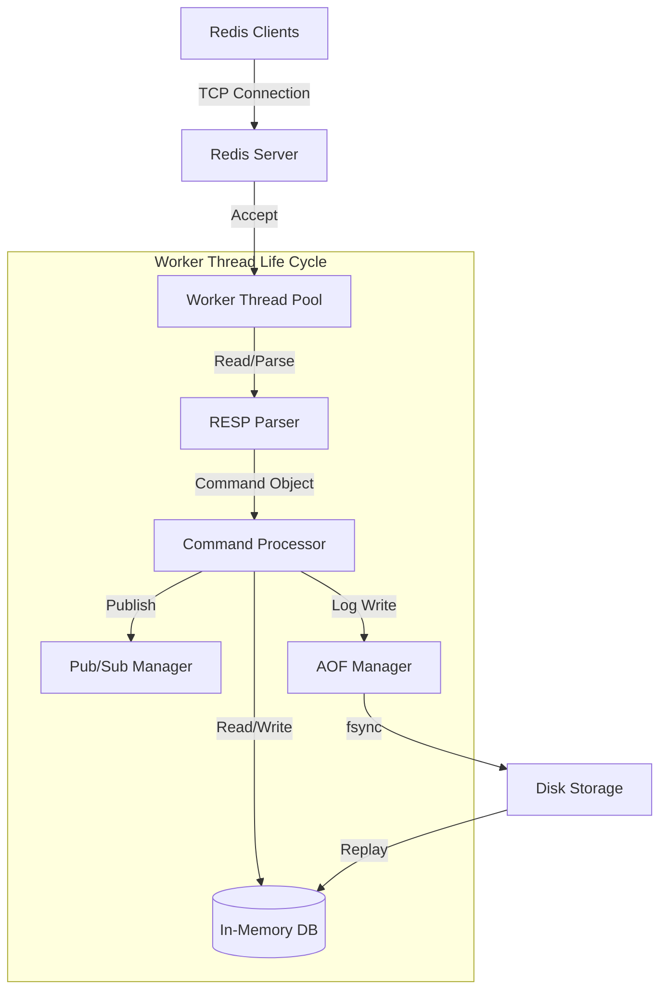

# Redis-In-Java

[](https://jdk.java.net/21/)
[](https://github.com/AshwinM0/redis-in-java/actions/workflows/ci.yml)
[](LICENSE)
[](https://redis.io/docs/latest/develop/reference/protocol-spec/)

> A Redis server built from scratch in Java — byte-exact RESP, durable AOF persistence, expiry with active and lazy reclamation, and Pub/Sub. Written to get the semantics right rather than to cover the most commands.

---

## 📖 Overview

**Redis-In-Java** is a clean-room implementation of the Redis server: an in-memory key-value store speaking the standard **RESP (Redis Serialization Protocol)**, so it can be driven by ordinary Redis clients such as `redis-cli`, Jedis or Lettuce.

This project showcases:
*   **System Design**: Clean separation of concerns (Networking, Protocol parsing, Command execution, Storage).
*   **Concurrency**: A thread per connection for I/O, with command execution serialised — the same model Redis uses.
*   **Persistence**: AOF logging with configurable durability, crash recovery, and compaction.
*   **Real-time Messaging**: Pub/Sub with per-connection write serialisation.

---

## 🏗 Architecture

The server uses blocking I/O with a thread per connection, chosen for clarity over raw throughput.



### Key Components

*   **Networking Layer**: `ServerSocket` with a thread per connection (blocking I/O). Concurrency lives here: parsing and socket waits for different clients overlap freely. Connections are capped by `REDIS_MAX_CLIENTS`, since each one holds a thread for as long as it stays open.
*   **Access Control**: Listens on `127.0.0.1` unless `REDIS_BIND` says otherwise, so a fresh install accepts connections from its own machine only. Setting `REDIS_PASSWORD` turns on `AUTH`: until a connection authenticates, every command except `AUTH` and `QUIT` is refused with `-NOAUTH`. Passwords are compared as SHA-256 digests in constant time. Traffic is not encrypted, so a server reachable over an untrusted network still needs a private network or a TLS tunnel in front of it.
*   **Protocol Handler**: Custom, zero-dependency RESP parser/writer. Binary-safe — bulk-string lengths are counted in bytes, so any payload survives a `SET`/`GET` round trip unchanged. Nesting depth, element counts and line lengths are all bounded, so a small malicious frame cannot cost the server unbounded memory or stack.
*   **Storage Engine**: An in-memory database whose methods are individually synchronised, so **commands execute one at a time**. This mirrors Redis, which is also single-threaded for command execution: a read-modify-write like `INCR` is indivisible by construction, and there is no lock-ordering surface to get wrong. It does mean throughput does not scale with cores.
*   **Expiry**: Lazy reclamation on access, plus a background cycle that samples keys with TTLs and keeps sampling while a pass finds many expired. Every read path goes through a single expiry gate, so a key that has lapsed is invisible to `GET`, `TYPE`, `EXISTS` and the hash commands alike.
*   **AOF Persistence Engine**:
    *   Logs write operations to an append-only file.
    *   Replays on startup, and refuses to start rather than serve a half-loaded dataset.
    *   Configurable `fsync` policies (`ALWAYS`, `EVERYSEC`, `NO`).
    *   **Group commit**: one writer thread does all the disk I/O, so writes that arrive during an fsync share the next one, and a write waiting on the disk holds no lock other clients need. Under `ALWAYS`, a write is acknowledged only once it is on disk.
    *   Stores expiries as **absolute deadlines**, so a restart does not hand a long-dead key a fresh TTL.
    *   `BGREWRITEAOF` compacts the log to the shortest command sequence that rebuilds the current data.

---

## 🚀 Features

### Core Capabilities
*   **🔌 RESP Compatible**: Speaks the standard protocol, so ordinary Redis clients can drive it for the commands it implements.
*   **🔢 Binary Safe**: Values are byte strings — UTF-8 text, protobuf, gzip and images all round-trip intact.
*   **⚙️ Configurable**: Via `.env` file or environment variables.

### Persistent Storage (AOF)
*   **Replay Mechanism**: Restores state from disk on startup.
*   **Safety**: Configurable fsync strategies to balance durability against speed.
*   **Compaction**: `BGREWRITEAOF` replaces the accumulated history with the current dataset.

### Pub/Sub System
*   `SUBSCRIBE` / `UNSUBSCRIBE`: Listen to channels.
*   `PUBLISH`: Broadcast messages to active subscribers.
*   Writes to a connection are serialised, so a delivered message and a command reply cannot interleave on the same socket.

### Supported Commands
| Category | Commands |
|----------|----------|
| **String** | `SET` (EX, PX, EXAT, PXAT, NX, XX, KEEPTTL), `SETNX`, `GET`, `GETSET`, `GETRANGE`, `MSET`, `MGET`, `APPEND`, `STRLEN`, `INCR`, `DECR`, `INCRBY`, `DECRBY`, `INCRBYFLOAT` |
| **Hash** | `HSET`, `HSETNX`, `HGET`, `HGETALL`, `HDEL`, `HLEN`, `HEXISTS` |
| **Keys** | `DEL`, `EXISTS`, `KEYS`, `TYPE`, `EXPIRE`, `PEXPIRE`, `PEXPIREAT`, `TTL`, `PTTL`, `FLUSHALL` |
| **Pub/Sub** | `PUBLISH`, `SUBSCRIBE`, `UNSUBSCRIBE` |
| **Server** | `PING`, `ECHO`, `COMMAND`, `AUTH`, `QUIT`, `BGREWRITEAOF` |

Not implemented: lists, sets, sorted sets, transactions, replication, RDB snapshots, and Lua scripting.

---

## 🛠 Getting Started

### Prerequisites
*   Java JDK 21+
*   Maven 3.6+

### Installation

1.  **Clone the repository**
    ```bash
    git clone https://github.com/AshwinM0/redis-in-java.git
    ```

2.  **Build**
    ```bash
    mvn clean package
    ```

3.  **Run**
    ```bash
    java -jar target/redis-1.0-SNAPSHOT.jar
    ```
    If the server cannot start (the port is taken, or the AOF file cannot be opened), it exits with code 1, so scripts and supervisors can tell a failed start from a clean shutdown.

### Configuration (.env)
Create a `.env` file in the root directory to customize your server:

```properties
# Server Port
REDIS_PORT=6379

# Address to listen on. 127.0.0.1 (the default) accepts connections from this
# machine only; 0.0.0.0 accepts them from anywhere, so set a password with it.
REDIS_BIND=127.0.0.1

# Require AUTH <password> before any other command (unset = no password).
# Use a long random value: AUTH is cheap, so a short password can be brute-forced.
# REDIS_PASSWORD=change-me-to-a-long-random-value

# Threading (0 = cached/unlimited)
REDIS_MAX_THREADS=0

# Close a client that has sent nothing for this many seconds (0 = never).
# Subscribers are exempt.
REDIS_TIMEOUT=0

# Refuse connections past this many concurrent clients
REDIS_MAX_CLIENTS=10000

# Persistence Configuration
REDIS_AOF_ENABLED=true
REDIS_AOF_PATH=Persistence/appendonly.aof
# Policies: ALWAYS (safest), EVERYSEC (balanced), NO (fastest)
REDIS_AOF_FSYNC=EVERYSEC
```

---

## 🧪 Testing

320 unit and integration tests, covering protocol round trips, expiry semantics, AOF replay across simulated restarts, concurrent read-modify-write under contention, authentication, and connection lifecycle over real sockets.

```bash
mvn test
```

Start a client and test manually:
```bash
redis-cli
127.0.0.1:6379> PING
PONG
127.0.0.1:6379> SET user:1 "Alice"
OK
127.0.0.1:6379> GET user:1
"Alice"
```

With `REDIS_PASSWORD` set, connect with `redis-cli -a <password>`, or from code with a URL such as `redis://:<password>@127.0.0.1:6379`.
